# Building a Car for Sable Mob Interactions

This guide walks through turning a vehicle into a car that mobs can drive and that spawns at your nodes. It uses the built-in default car as the example, so you can open that car in a test world and follow along.

You will need Create, Sable, Simulated, and Sable Mob Interactions installed, plus a creative world to build in.

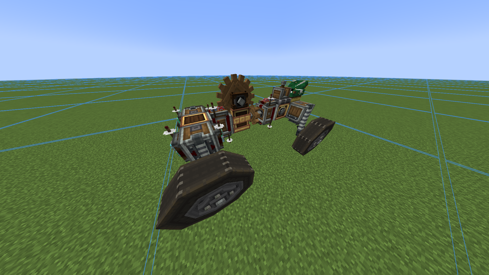

## Before you start

A car is a normal Sable vehicle with three extra things:

- A **Mob Transmitter** seat where the pilot sits
- **Redstone Links** wired to the parts that make the car go forward, go backward, and turn
- A **Physics Assembler** (from Simulated) that turns the placed structure into a moving sub-level when it spawns

Build the car so it drives properly when you control it yourself first. The mob driver uses the same controls you would.

## Step 1: Place the Mob Transmitter

Get a Mob Transmitter and place it on your car so the seat faces the front of the vehicle. The way the seat points is the way the pilot treats as forward, so this matters.

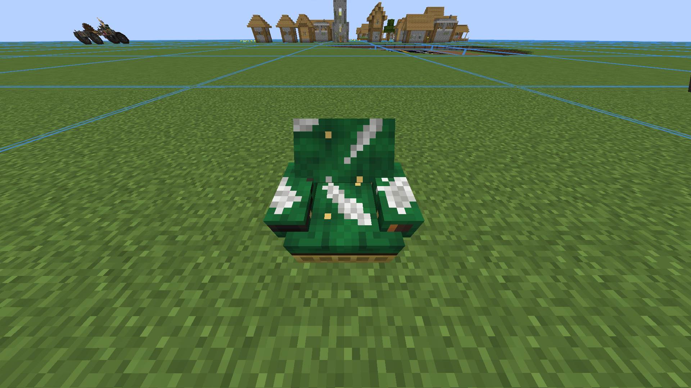

## Step 2: Fit Redstone Links to the drive parts

Put Redstone Links on the parts that control movement:

- **Forward**: whatever makes the car drive forward
- **Backward**: whatever makes it reverse
- **Left and right**: whatever turns the car

On the default car these sit on the gearboxes and steering mechanism, with each link placed on the part it controls.

## Step 3: Bind a Redstone Controller

Take a Redstone Controller, enter bind mode, and point it at each link in turn. When the "Bind mode active" message appears, press the key you want that link to answer to. The usual layout is:

- W for forward
- S for backward
- A for left
- D for right

Repeat for every link until all four directions are bound. Then test the car yourself with the controller to check it drives the way you expect.

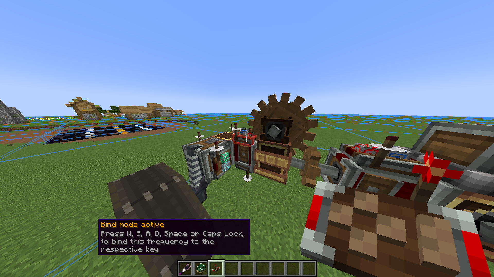
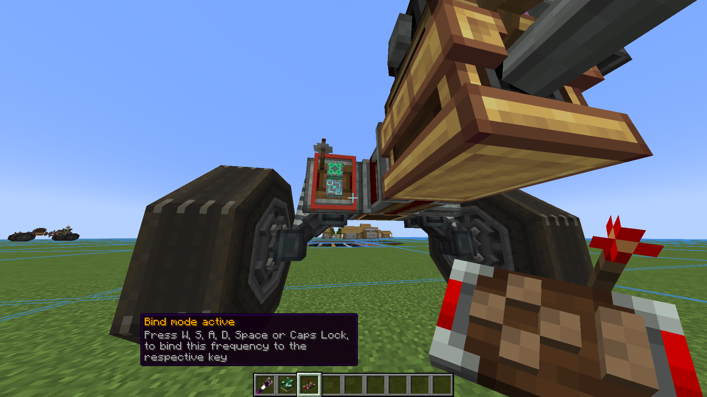
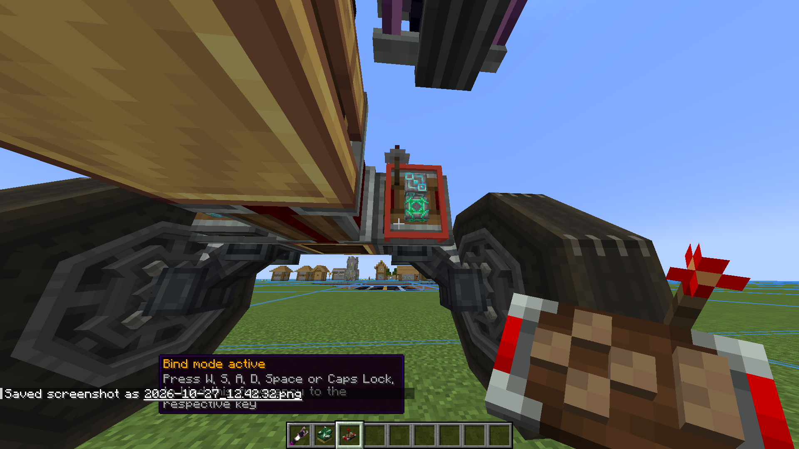
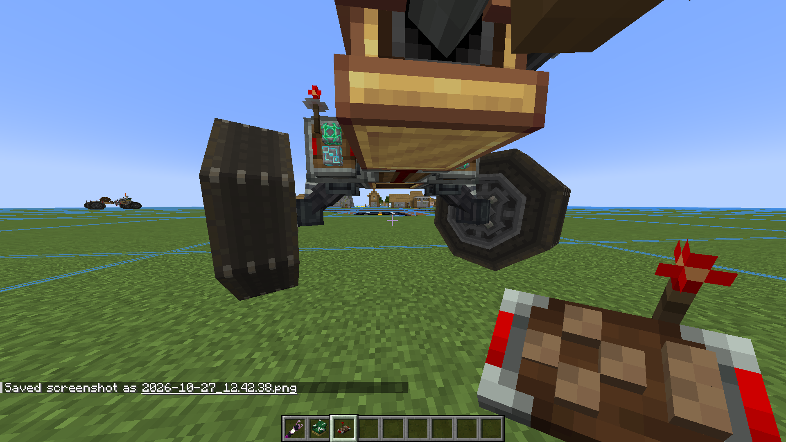

## Step 4: Copy the frequencies to the Mob Transmitter

Hold the bound controller and right click the Mob Transmitter seat. You should see this message:

**Copied 4 of 4 drive frequencies from the controller**

If it says fewer than 4, one of your directions isn't bound yet. Go back to step 3 and bind the missing one.

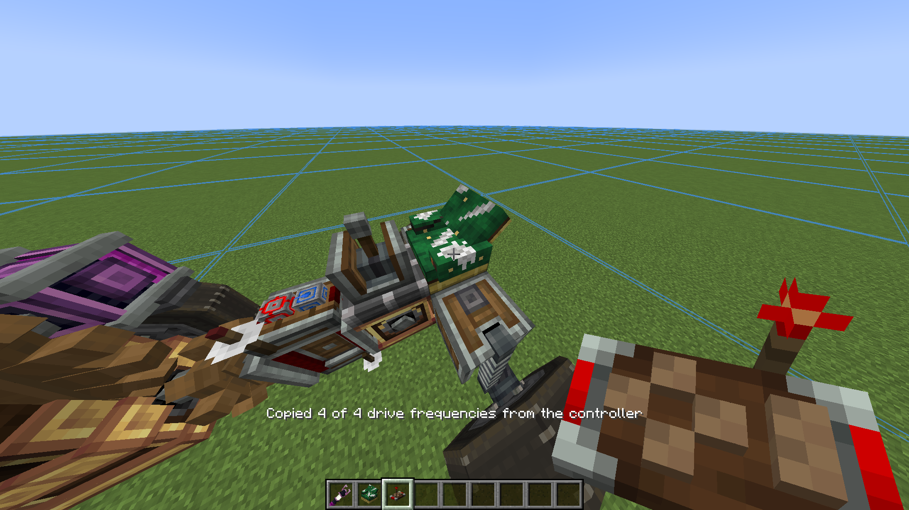

You don't need to make the frequencies unique. Every time the car spawns, its Redstone Link frequencies are randomised automatically, so two copies of the car never interfere with each other.

## Step 5: Save the schematic

Use a Create Schematic and Quill to select the whole car. Include everything: the seat, the links, the assembler, and the wheels. Then save it with a name you will recognise.

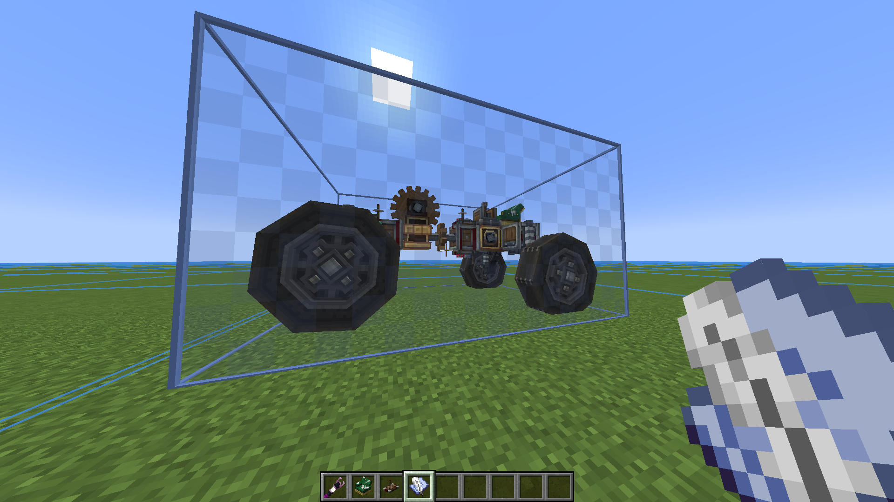

## Step 6: Find the schematic

Open your Minecraft instance folder and go to `schematics`. Your saved file will be there as a `.nbt` file.

## Step 7: Copy it

Copy the `.nbt` file.

## Step 8: Open your world's vehicles folder

Go to `saves/<your world>/vehicles`. This folder is created for each world and holds one folder per tier.

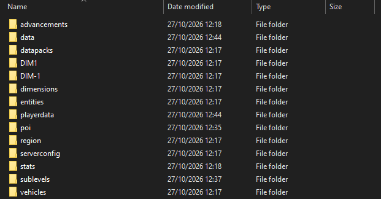

## Step 9: Choose the tier

Open the folder for the tier you want your car to belong to. Rarer tiers spawn further from the world's centre.

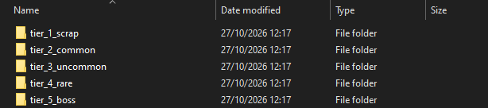

- `tier_1_scrap`
- `tier_2_common`
- `tier_3_uncommon`
- `tier_4_rare`
- `tier_5_boss`

## Step 10: Paste the file

Paste your `.nbt` into the tier folder. The mod rescans these folders when files change, so it joins that tier's spawn pool straight away.

If the folder only contains the built-in default car, you can delete that file to make sure only your own cars spawn. If a tier's folder is ever empty, the default car is installed again.

## Step 11: Spawn it

Load a new world, or go to a node that hasn't filled with cars yet. Your car spawns beside the node, assembles itself, and a mob climbs into the seat and starts driving.

## Troubleshooting

- **The car spawns but nobody drives:** the seat is missing, or the Mob Transmitter doesn't have all 4 frequencies. Redo step 4.
- **It drives backwards or turns the wrong way:** the car works this out itself on the first run, but if it keeps failing, check that the seat faces the front (step 1).
- **It never assembles and turns into a wreck:** the Physics Assembler is missing or blocked. Make sure it is inside the saved area.
- **Nothing spawns from your file:** check that the file is a `.nbt` and sits directly inside the tier folder, not in a sub folder.
- **Use `/sablemobinteractions customcars`** to list the cars the mod has found for each tier, and `/sablemobinteractions debugdrive true` to see what a pilot is doing.

## For the curious

The frequencies you copied are stored in the car file itself, inside the Mob Transmitter block entity. You can open the `.nbt` in an NBT editor and see one entry each for forward, backward, left and right.

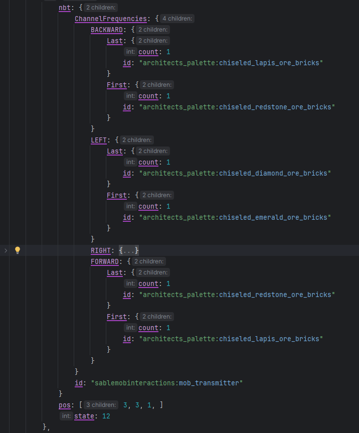
